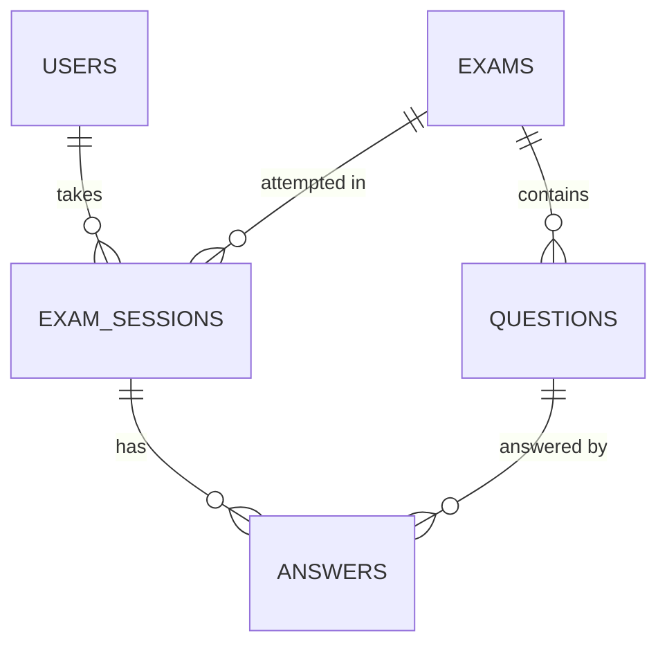

# Project Plan: Robust CBT (Computer-Based Testing) Solution

## 1. Goal and guiding principle

Admins create timed multiple-choice exams. Students take them in the browser. The server grades.

The design follows one principle: **never trust the client.** That gives four rules the whole system is built around:

1. **Answers never leave the server during an exam.** Student-facing responses do not contain correct answers.
2. **The server owns the clock.** The browser countdown is a display only; the server decides what is on time.
3. **The server grades.** The client sends chosen options, never a score.
4. **State lives on the server.** A refresh or a dropped connection loses nothing.

## 2. Tech stack and why

| Layer    | Choice                                   | Why (driven by project needs)                                                                                                                                                                                                                        |
| -------- | ---------------------------------------- | ---------------------------------------------------------------------------------------------------------------------------------------------------------------------------------------------------------------------------------------------------- |
| Backend  | NestJS + TypeScript                      | Declarative input validation (DTOs and pipes), one central place for safe error responses (exception filter), dependency injection so the timer can be tested with a fake clock, modules that enforce separation of concerns, guards for role checks |
| Database | PostgreSQL (Neon)                        | Relational data with foreign keys; transactions and row locking so concurrent submits cannot both succeed                                                                                                                                            |
| ORM      | TypeORM                                  | First-class transactions and pessimistic row locks, which the submit path needs                                                                                                                                                                      |
| Frontend | React + TypeScript (Vite)                | Required by the brief; TypeScript keeps request and response shapes aligned with the backend                                                                                                                                                         |
| Auth     | JWT + role guard                         | Admin and student separation, plus per-session ownership checks                                                                                                                                                                                      |
| Tests    | Jest (unit + integration with Supertest) | Standard for NestJS                                                                                                                                                                                                                                  |

## 3. Architecture

```
iboss-cbt/
├── backend/src/
│   ├── auth/       register, login, JWT, role guard
│   ├── users/      users table
│   ├── exams/      exams and questions (admin CRUD, student list)
│   ├── sessions/   start, resume, save answer, submit, timer rules, question shuffle
│   ├── grading/    scoring only
│   ├── common/     Clock service, error filter, shared helpers
│   └── database/   connection setup, admin seed script
├── frontend/src/
│   ├── api/        all server calls in one place
│   ├── pages/      Login, ExamList, ExamSession, Result, admin screens
│   ├── components/ QuestionView, QuestionNavigator, Timer
│   └── hooks/      countdown and session-loading logic
├── project_plan.md
├── AI_USAGE.md
└── README.md
```

Each backend module has the same inner shape: **controller** (receive, validate, call a service, respond), **service** (the rules), **entity** (table), **DTOs** (allowed input and output shapes).

Three boundaries that must hold:

1. `grading/` never touches the database. It takes questions and answers in and returns a score out, so it is a pure unit-testable function.
2. Timer rules live in one place (`sessions/`) and read time only from the injected `Clock` service.
3. Controllers contain no business rules.

## 4. Data model



| Table           | Key columns                                                                                                           | Notes                                                                                                                                |
| --------------- | --------------------------------------------------------------------------------------------------------------------- | ------------------------------------------------------------------------------------------------------------------------------------ |
| `users`         | id, name, email (unique), password_hash, role (`admin` or `student`)                                                  | Passwords are hashed (bcrypt), never stored in plain text                                                                            |
| `exams`         | id, title, duration_minutes, pass_mark_percent, created_at                                                            | One row per test                                                                                                                     |
| `questions`     | id, exam_id, text, options (JSON list), correct_index, position                                                       | The only table holding correct answers. Student endpoints never select `correct_index`                                               |
| `exam_sessions` | id, exam_id, user_id, started_at, expires_at, submitted_at, status, score, question_order (JSON list of question ids) | `UNIQUE (user_id, exam_id)`. `expires_at` is computed once at start. Status: `in_progress`, `submitted`, `submitted_late`, `expired` |
| `answers`       | id, session_id, question_id, selected_index                                                                           | `UNIQUE (session_id, question_id)`; changing an answer updates the row                                                               |

Design notes:

- **Options as a JSON column**, with the correct answer stored as an index. Options are always read and written together with their question, so a separate table adds a join and code with no benefit for this scope.
- **`expires_at` is stored, not recomputed.** If an admin edits the exam duration later, a running session's deadline does not move.
- **`question_order` is stored per session** so the shuffled order stays stable across refreshes.

## 5. API

| Who     | Endpoint                                        | Purpose                                                             |
| ------- | ----------------------------------------------- | ------------------------------------------------------------------- |
| Public  | `POST /auth/register`                           | Create a student account (role is never client-chosen)              |
| Public  | `POST /auth/login`                              | Verify credentials, return a JWT                                    |
| Admin   | `POST /exams`                                   | Create an exam                                                      |
| Admin   | `GET /exams/:id/admin`                          | View an exam with questions and correct answers                     |
| Admin   | `PATCH /exams/:id`, `DELETE /exams/:id`         | Edit or remove an exam                                              |
| Admin   | `POST /exams/:id/questions`                     | Add a question                                                      |
| Admin   | `PATCH /questions/:id`, `DELETE /questions/:id` | Edit or remove a question                                           |
| Admin   | `GET /exams/:id/results`                        | View all graded attempts                                            |
| Student | `GET /exams`                                    | List exams (no questions, no answers)                               |
| Student | `POST /exams/:id/sessions`                      | Start the exam; a duplicate start returns the existing session      |
| Student | `GET /sessions/:id`                             | Resume: questions in stored order, saved answers, remaining seconds |
| Student | `PUT /sessions/:id/answers/:questionId`         | Save one answer immediately                                         |
| Student | `POST /sessions/:id/submit`                     | Submit; the server grades and returns the result                    |
| Student | `GET /sessions/:id/result`                      | View the result of a submitted session                              |

## 6. How the hard parts work

### 6.1 Answers are never leaked

Student and admin views are **separate endpoints with separate response types**. The student response type does not contain a correct-answer field, so there is nothing to leak by accident. A test asserts that the student payload contains no correct answer anywhere.

### 6.2 Timer synchronization

- At session start the server computes `expires_at = now + duration` and stores it.
- Every session response includes **remaining seconds, calculated by the server**. The browser counts down locally for display and **re-syncs from the server** on every load and every answer save.
- All time comparisons use a single injected `Clock` service. Tests replace it with a fake clock to simulate expiry.

| Event                                   | Rule                                                                                                                                                            |
| --------------------------------------- | --------------------------------------------------------------------------------------------------------------------------------------------------------------- |
| Save an answer                          | Allowed only before `expires_at`; afterwards rejected. Every stored answer was therefore made in time                                                           |
| Submit within `expires_at` + 10 s grace | Accepted, status `submitted`. The grace covers network latency for the browser's auto-submit at 00:00                                                           |
| Submit after the grace                  | Accepted but flagged `submitted_late`, visible to the admin                                                                                                     |
| Never submitted                         | When the session is next accessed after `expires_at` + grace, the server closes it itself, grades the saved answers, status `expired`. No background job needed |

Flagging (rather than rejecting) late submissions means an honest student with a dropped connection still gets a result, and nobody gains anything by being late because answers made after expiry were never stored.

### 6.3 Concurrency and double submission

Submit runs inside a **database transaction with a pessimistic row lock** on the session. If an auto-submit and a manual click race, one waits for the other; the second sees the session is already finalized and returns the same result. Grading happens once.

Starting an exam is protected by `UNIQUE (user_id, exam_id)`. If two start requests race, the database lets one insert win and the other request returns the existing session.

Saving an answer to an already-submitted session returns `409 Conflict`.

### 6.4 Grading

Grading is a pure function in `grading/`: it receives the questions (with correct indices) and the stored answers, and returns score, percentage, pass or fail, and a per-question breakdown. It matches by question id, so the shuffled order has no effect. Unanswered questions count as incorrect.

### 6.5 Question shuffle

Questions are shuffled **once per student, on the server**, at session start, using **Fisher-Yates** (not `sort(() => Math.random() - 0.5)`, which is biased). The resulting list of ids is stored in `question_order` and reused on every resume. Answer options keep the admin's order for every student.

### 6.6 Authentication and authorization

- **Authentication:** register and login, passwords hashed, JWT sent in the `Authorization` header.
- **Authorization:** a role guard protects admin routes; an **ownership check** ensures a student can only read, answer, or submit their own sessions. Someone else's session returns `404` (not `403`) so ids cannot be probed.
- Registration always creates a `student`. Admins come from a seed script.

### 6.7 Validation and errors

All input goes through DTO validation (types, ranges, unknown fields rejected). A global exception filter returns consistent, safe messages with no stack traces or internals. Examples: unknown question, option index out of range, question belonging to a different exam, malformed body.

## 7. Task breakdown and scoping

The brief estimates 5 to 7 hours. I scoped a **core MVP that fits about 7 hours**, then listed what I added on top and why.

### Core (about 7 hours)

| Milestone                                                                                    | Est.  |
| -------------------------------------------------------------------------------------------- | ----- |
| Setup: repo, NestJS and React scaffolds, database connection, entities                       | 0.5 h |
| Exams and questions: admin CRUD, student list, separate response shapes                      | 1.0 h |
| Sessions: start, resume, save answer, submit, timer rules, shuffle                           | 1.5 h |
| Grading and results                                                                          | 0.5 h |
| Core tests (the 4 required scenarios)                                                        | 1.0 h |
| React student flow: exam screen, countdown, navigator, refresh recovery, auto-submit, result | 1.5 h |
| React admin screens (minimal)                                                                | 0.5 h |
| Documentation: README(s), this plan, AI_USAGE.md                                             | 0.5 h |

### Added scope (about 3 hours), and why

| Addition                                                                                        | Est.  | Reason                                                                                                                        |
| ----------------------------------------------------------------------------------------------- | ----- | ----------------------------------------------------------------------------------------------------------------------------- |
| Authentication and authorization (users, JWT, role guard, ownership check)                      | 1.5 h | Access control is central to the security criterion, and an open admin API would undermine the "answers not leaked" guarantee |
| Extra tests (ownership, roles, duplicate start, double submit, lazy expiry, shuffle properties) | 1.0 h | These prove the concurrency and security claims above                                                                         |
| UI polish                                                                                       | 0.5 h | Smoother navigation and clear states                                                                                          |

Estimates are planned figures. If I cut scope under time pressure, the order is: UI polish, then extra tests, and never the four required tests or the timer logic.

## 8. Testing

Unit tests need no database. Integration tests start the real app and use a **separate test database** so real data is never touched.

**Required scenarios**

1. Starting a session: the response contains no correct answers.
2. Grading accuracy (unit): 4 questions, 3 correct gives 3/4, 75%, pass at a 50% pass mark.
3. Timer, using a fake clock: saving after expiry is rejected; submitting inside the grace window is `submitted`; submitting after it is `submitted_late`.
4. Invalid input: unknown question, option index out of range, question from another exam, malformed body, and an already-submitted session (`409`).

**Extras**

5. Another student's session returns `404`.
6. A student calling an admin endpoint gets `403`; no token gets `401`.
7. A duplicate start returns the same session.
8. A double submit returns the same result and grades once.
9. An abandoned session is closed as `expired` on next access.
10. Shuffle properties: stored order has exactly the exam's question ids with no duplicates, resume returns the identical order, and score is unaffected by order.

## 9. Assumptions

- One attempt per student per exam.
- Questions are single-answer multiple choice.
- Unanswered questions score zero; there is no negative marking.
- An exam's questions cannot be edited or deleted once any session exists for it (returns `409`), so stored question orders never go stale.
- The pass mark is a percentage set per exam.
- Network delay is covered by a 10-second grace window, kept as a named setting.

## 10. Trade-offs made for this MVP

| Decision                                        | Trade-off                                                                                                               |
| ----------------------------------------------- | ----------------------------------------------------------------------------------------------------------------------- |
| Single attempt per exam                         | No retakes; production would let an admin reset an attempt                                                              |
| Options stored as JSON on the question          | Cannot query individual options cheaply; fine because options are only ever read with their question                    |
| Late submissions are flagged, not rejected      | Admin reviews flagged attempts; chosen so honest network failures are not punished                                      |
| Lazy expiry instead of a background job         | An abandoned session is only finalized when next accessed, which is simpler and sufficient for an MVP                   |
| Single `Clock` source in application code       | Several app instances could drift slightly; production would use database time or synchronized clocks                   |
| Fixed question order per session, shuffled once | Reduces copying; per-option shuffling was skipped because it would require an option-order mapping in the riskiest code |
| TypeORM schema auto-sync                        | Fast for an MVP; production would use migrations                                                                        |
| Neon free tier                                  | First request after idle can be slow (cold start)                                                                       |

## 11. Known gaps and next steps

- Refresh tokens, password reset, email verification, and rate limiting on login are not implemented.
- No admin UI to reset an attempt or allow retakes.
- No pagination on admin results.
- Option shuffling and per-student question pools are possible extensions.
- Move to database-side time and migrations for a multi-instance deployment.

## 12. Time actually spent
